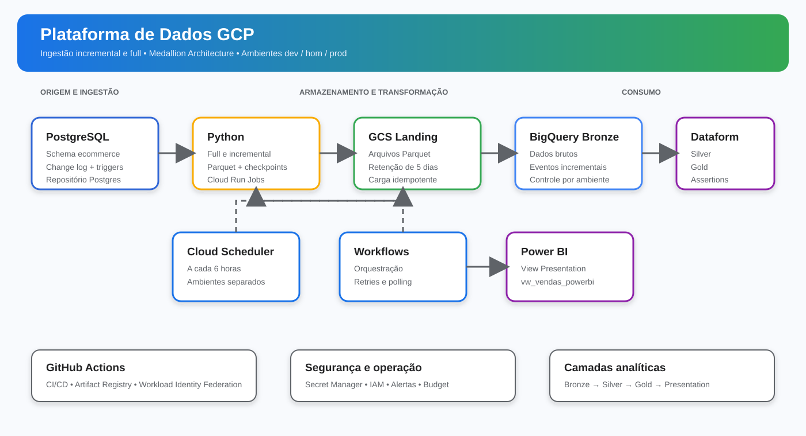

# Plataforma de Dados GCP

Pipeline de dados para extrair PostgreSQL, armazenar arquivos Parquet no
Google Cloud Storage, carregar a camada Bronze no BigQuery e transformar os
dados com Dataform.

## Arquitetura



```text
PostgreSQL
    -> Python / Cloud Run Jobs
    -> GCS Landing (Parquet)
    -> BigQuery Bronze
    -> Dataform Silver
    -> Dataform Gold
    -> View Presentation para consumo analitico
```

O change log PostgreSQL registra `INSERT`, `UPDATE` e `DELETE`. A ingestão
incremental utiliza checkpoints independentes por ambiente.

## Ambientes

Os ambientes usam datasets separados no mesmo projeto GCP:

- `dev`: desenvolvimento e validação;
- `hom`: homologação;
- `prod`: produção.

Cada ambiente possui seus próprios datasets, buckets, jobs Cloud Run,
Workflow, configuração Dataform e alertas.

## Componentes

- Python 3.12;
- PostgreSQL;
- Google Cloud Storage;
- BigQuery;
- Dataform;
- Cloud Run Jobs;
- Workflows;
- Cloud Scheduler;
- GitHub Actions com Workload Identity Federation.

## PostgreSQL de demonstração

O PostgreSQL com o schema `ecommerce`, os dados de exemplo e a configuração
da origem está em um repositório separado:

[paulormf/Postgres](https://github.com/paulormf/Postgres)

Para reproduzir este projeto localmente:

1. Clone e inicialize o repositório `Postgres`.
2. Inicie o PostgreSQL conforme as instruções daquele repositório.
3. Confirme que o banco `appdb` está acessível na porta configurada.
4. Execute neste projeto as migrations de auditoria em
   [`sql/source/`](sql/source/).
5. Configure `SOURCE_DATABASE_URL` no `.env` deste projeto.

Este repositório não contém a imagem Docker nem os dados do PostgreSQL de
demonstração. Ele contém somente a plataforma de ingestão e transformação.

## Configuração local

```powershell
Copy-Item .env.example .env
```

Edite `.env` com a URL real do PostgreSQL. O arquivo `.env` não deve ser
commitado.

Para executar a ingestão incremental localmente:

```powershell
python -m ingestion.incremental.cli --environment dev --page-size 1000
```

O full load é executado separadamente e apenas quando necessário:

```powershell
python -m ingestion.full.cli --environment dev --tables categorias --batch-size 50000
```

## Operação em produção

O fluxo incremental é executado pelo Cloud Scheduler a cada 6 horas. O full
load é manual. O procedimento de operação e recuperação está em
[`docs/operations/01-runbook-operacional.md`](docs/operations/01-runbook-operacional.md).

## Segurança

- Segredos ficam no Secret Manager ou no ambiente local não versionado;
- o `.env` está no `.gitignore`;
- o GitHub Actions usa Workload Identity Federation, sem chave JSON;
- dados pessoais são protegidos antes da publicação na Gold;
- assertions do Dataform validam a qualidade dos dados.

## Documentação

- [`docs/architecture/`](docs/architecture/): decisões e contratos da solução;
- [`docs/operations/`](docs/operations/): procedimentos operacionais;
- [`orchestration/workflows/`](orchestration/workflows/): Workflows GCP;
- [`.github/workflows/deploy.yml`](.github/workflows/deploy.yml): CI/CD.
